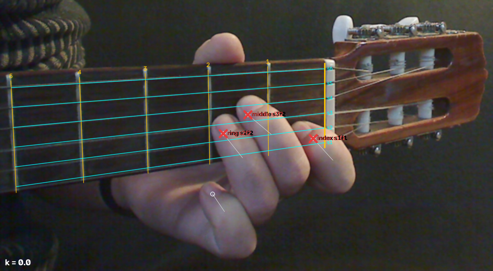

# FretCoach：吉他和弦指法即時矯正系統

政大 115-1 人機互動（HCI）期末專題。

FretCoach 用一台 webcam 看吉他初學者的左手，即時判斷「哪一根手指按錯了」，並在畫面上標出該移到哪裡。

- 手部追蹤：MediaPipe Hand Landmarker（21 個關節點）
- 指板定位：點四下校正 + homography，琴格位置用十二平均律計算
- 判斷與回饋：接觸點修正、多畫面平均、dwell（手指停穩才判斷，避免 Midas touch）

## 目前進度

這是 proposal 階段的技術可行性研究。用一張真實的 Am 和弦照片測試：

| 做法 | 三指全部判斷正確 |
| --- | --- |
| 直接用 MediaPipe 的指尖點 | 0 / 3（每根手指都偏到隔壁弦） |
| 接觸點修正（k = 0.4） | 3 / 3 |
| 加入影像擾動後，單一畫面 | 58% |
| 加入影像擾動後，平均 10 個畫面 | 94% |

MediaPipe 每格處理時間約 3 ms。完整數據、方法和限制請看 [技術研究報告](技術研究報告.md)。

| 不修正 | 修正後 |
| --- | --- |
|  |  |

## 內容

| 位置 | 內容 |
| --- | --- |
| [`技術研究報告.md`](技術研究報告.md) | 技術可行性研究：誤差預算、五個實驗、設計決策、建議的方法與函式庫 |
| [`FretCoach_Proposal.docx`](FretCoach_Proposal.docx) | 專題 proposal |
| [`demo/`](demo/) | 程式碼與 webcam 即時 demo，安裝與執行方式見 [demo/README.md](demo/README.md) |
| [`results/`](results/) | 實驗圖表與疊圖、`summary.json` |
| [`test_images/`](test_images/) | 測試照片（Wikimedia Commons，授權見 [ATTRIBUTION.md](test_images/ATTRIBUTION.md)） |

## 快速開始

```bash
cd demo
uv venv --python 3.11 .venv
uv pip install --python .venv/bin/python -r requirements.txt
mkdir -p models && curl -L -o models/hand_landmarker.task \
  https://storage.googleapis.com/mediapipe-models/hand_landmarker/hand_landmarker/float16/latest/hand_landmarker.task
.venv/bin/python webcam_demo.py --guitar steel --chord Am
```

按 `c` 校正指板（依序點：第 6 弦在琴枕處、第 1 弦在琴枕處、第 6 弦在第 5 格、第 1 弦在第 5 格），按 `1`–`8` 切換和弦。

## 限制

目前只用一張照片驗證過，webcam demo 還沒有用真實吉他實測。詳見[技術研究報告第 6 節](技術研究報告.md#6-限制)。
