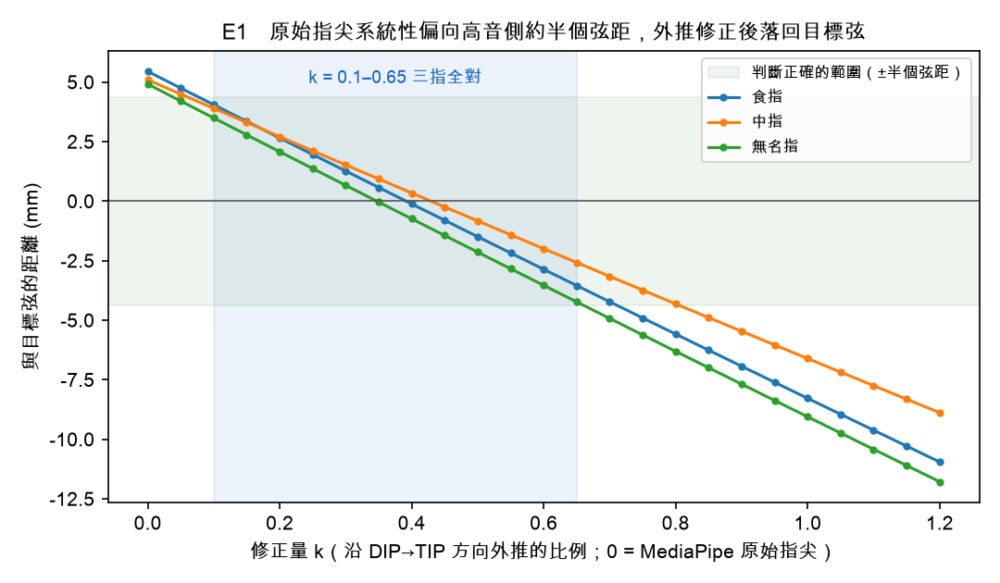
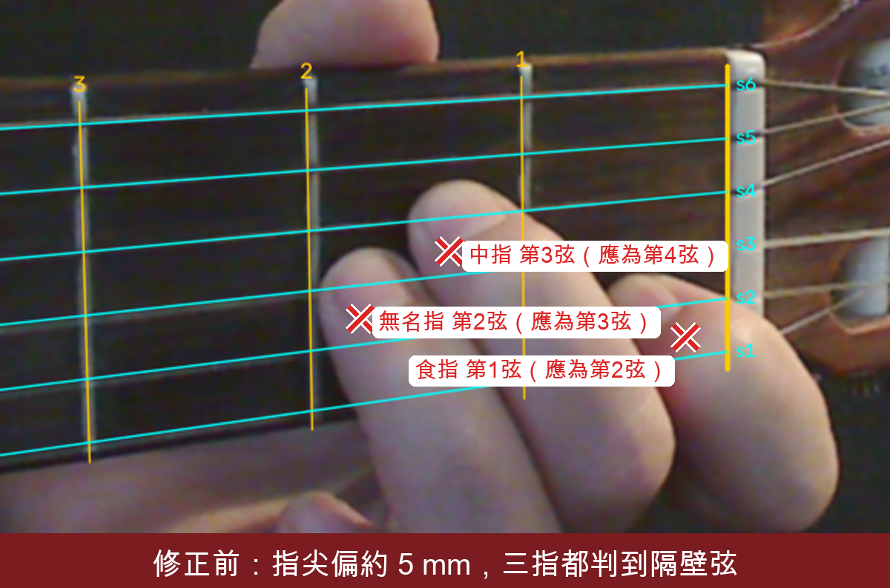
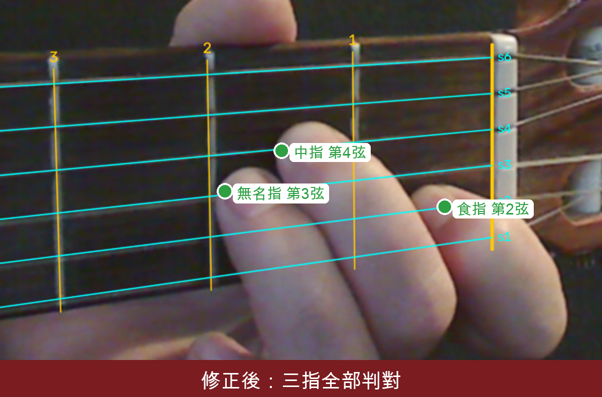
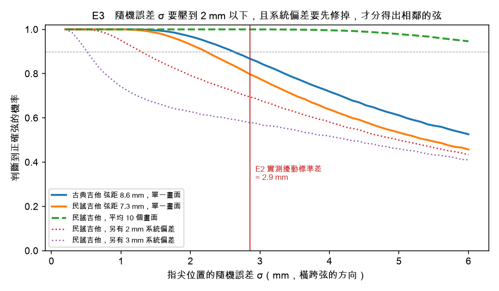
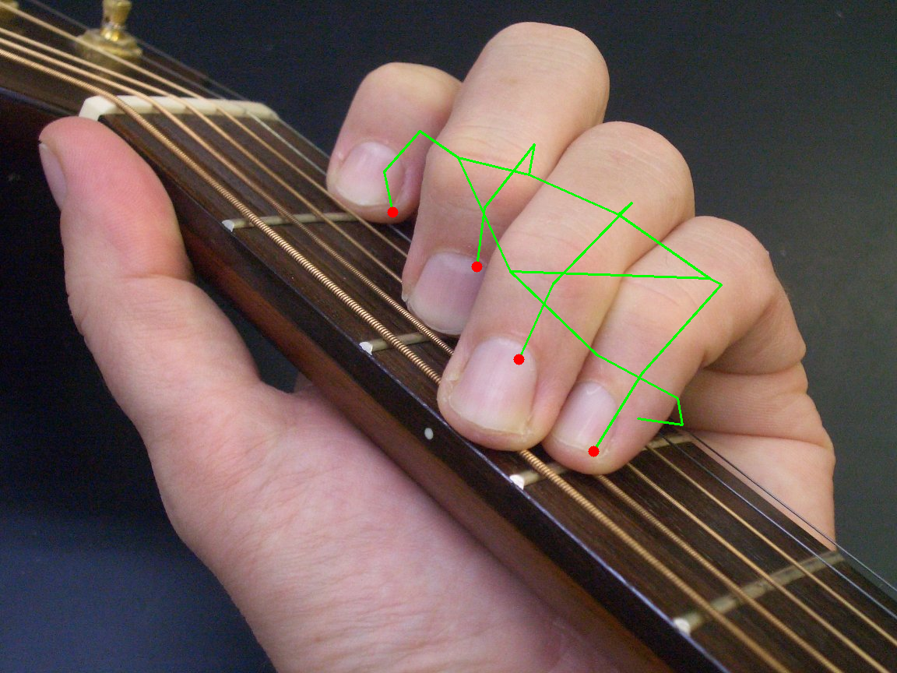
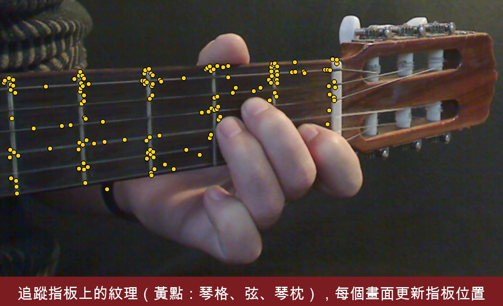
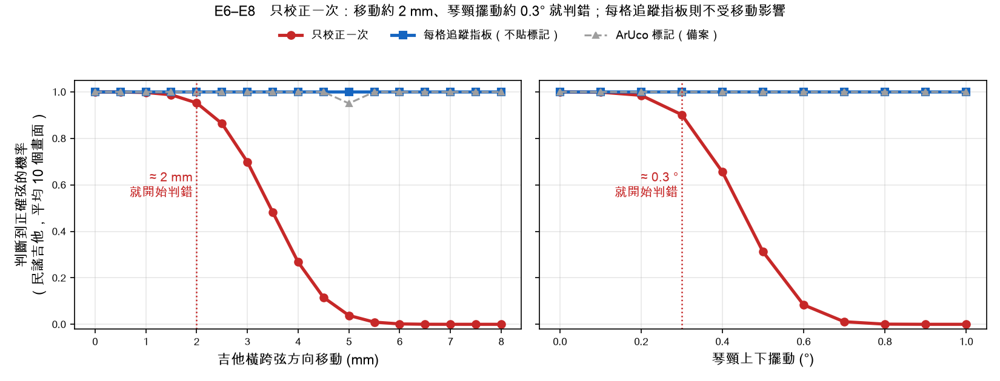
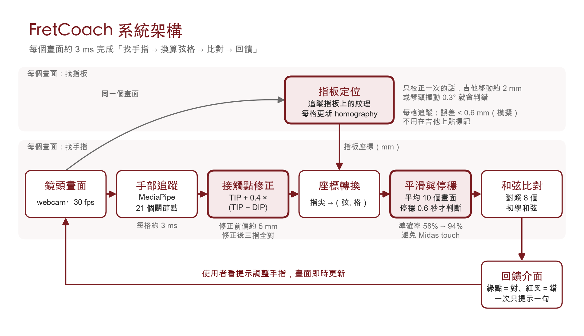

# FretCoach 技術可行性研究

HCI 期末專題的完整研究紀錄（2026-11-14 至 11-18）：選題、課程對應、市場調查、技術可行性實驗、方法與函式庫、簡報與講稿，都整理在這一份。

## 目錄

- [一頁總結](#一頁總結)
- [1. 專題概要](#1-專題概要)
- [2. 與課程內容的對應](#2-與課程內容的對應)
- [3. 市面上的類似產品與研究](#3-市面上的類似產品與研究)
- [4. 難度評估](#4-難度評估)
- [5. 為什麼「判斷是哪一弦」最難](#5-為什麼判斷是哪一弦最難)
- [6. 可行性實驗](#6-可行性實驗)
- [7. 實驗帶來的設計決策](#7-實驗帶來的設計決策)
- [8. 方法（proposal 第 3 節）](#8-方法proposal-第-3-節)
- [9. API／函式庫（proposal 第 4 節）](#9-api函式庫proposal-第-4-節)
- [10. 限制與下一步](#10-限制與下一步)
- [11. 簡報與講稿](#11-簡報與講稿)
- [12. 檔案與連結](#12-檔案與連結)
- [參考資料](#參考資料)

---

## 一頁總結

**FretCoach 用一台 webcam 看吉他初學者的左手，即時指出哪根手指按錯、該移到哪裡。** 我負責 proposal 的第 3 節（方法）和第 4 節（API／函式庫）。

**吉他保持不動時，技術上做得到，但有三個前提：**

1. **指尖點要修正**：MediaPipe 的指尖點偏向手掌約 5 mm，比半個弦距還多。不修正的話，每根手指都判到隔壁弦。
2. **要多畫面平均**：單一畫面判斷三指全對只有 58%，平均 10 個畫面後提高到 94%。
3. **鏡頭要拍到手掌和手腕**：只拍到手指的特寫，MediaPipe 根本找不到手。

**最大的問題是吉他會移動。** 只校正一次的話，吉他移動約 **2 mm**、或琴頸上下擺動約 **0.3°** 就開始判錯，彈奏時幾乎一定會超過。**解法是每個畫面自動追蹤指板，不需要貼任何東西**；模擬測試中不論怎麼移動，校正誤差都在 0.55 mm 以內（6.6 節）。

| 關鍵數字 | 值 | 出處 |
| --- | --- | --- |
| 相鄰弦距（民謠吉他） | 約 7.3 mm，容許誤差 ±3.6 mm | 5.1 |
| MediaPipe 原始指尖偏差 | 約 5 mm（三指方向相同） | 6.1 |
| 修正後（k = 0.4） | 三指全對；k 在 0.10–0.65 都可 | 6.1 |
| 單一畫面 → 平均 10 個畫面 | 58% → 94% | 6.2 |
| 每格處理時間 | 3.0 ms（課堂門檻 100 ms） | 6.4 |
| 只校正一次的移動容忍度 | 約 2 mm 或琴頸擺動 0.3° | 6.6 |
| 每格追蹤指板的誤差（不貼標記） | 中位數 0.11 mm，最差 0.55 mm | 6.6 |

### 常見問題的直接回答

| 問題 | 回答 |
| --- | --- |
| 移動就要重新校正，是最大的問題嗎？ | **是最大的工程問題。** 容忍度只有約 2 mm／0.3°。另一個最大的未知數是真實環境的準確率：目前只用一張照片驗證過 |
| 保持不動的話，demo 辨識效果好嗎？ | **在測試照片上很好**：修正後三指全對，平均 10 格後 94%，模擬影片 90/90 格全對。但只有一張照片、一個人、一個和弦，還沒用真實 webcam 和吉他測過 |
| 移動多少就要重新校正？ | 橫跨弦方向約 2 mm（古典吉他 2.5 mm）、沿琴頸約 2 mm、琴頸以琴身為軸擺動約 0.3°；靠近或遠離鏡頭 10% 以內影響不大 |
| 預計怎麼解決？ | 主要方案：每個畫面追蹤指板上的紋理，自動更新位置，不用貼任何東西。之後再訓練模型偵測指板，取代開始時的手動校正。ArUco 標記是最後的備案 |
| ArUco 是必要的嗎？ | 不是。必要的是「每格重新定位指板」，追蹤指板紋理就做得到，而且模擬中比 ArUco 更準 |

**跟現有產品的差別**：市面上的學習 app 和 LED 指板都靠聲音判斷對錯，看不到手。學生專題已經有人用鏡頭辨識和弦，但幾乎都只做到「辨識出來」。我們的重點是 HCI：**回饋怎麼設計**才真的幫助學習，並找初學者做對照實驗驗證。

---

## 1. 專題概要

完整 proposal 見 [FretCoach_Proposal.docx](FretCoach_Proposal.docx)。

### 1.1 要解決的問題

自學吉他的人聽得出「聲音怪怪的」，卻看不出「是哪根手指的問題」。錯誤的手型反覆練習後，就變成習慣。

初學者常見的按弦錯誤：

- 按錯弦：手指落在相鄰的弦上。
- 按錯格：手指落在錯誤的琴格。
- 位置偏離琴格：手指離琴格金屬條太遠，產生雜音。
- 碰到鄰弦：手指不夠立，把旁邊的弦悶住。
- 用錯手指：位置對了，但指法不利於之後換和弦。

### 1.2 研究問題

1. **RQ1（可行性）**：單一 RGB 鏡頭能否以足夠的準確率，即時判斷每根手指的弦與格？
2. **RQ2（成效）**：與靜態和弦圖相比，即時視覺回饋能否縮短初學者按對和弦的時間、減少錯誤？
3. **RQ3（經驗）**：即時回饋會不會增加認知負荷，或讓使用者過度依賴系統？

### 1.3 使用者實驗設計

- **受試者**：12 位吉他初學者（學習未滿 3 個月或從未學過）。
- **設計**：受試者內設計，兩個條件的順序以平衡法輪替。對照組只看靜態和弦圖，實驗組使用 FretCoach。
- **任務**：每個條件學 3 個新和弦，兩組難度相當（A 組 Am、C、Dm；B 組 Em、G、D），每個和弦練習 3 分鐘。
- **保留測驗**：休息 5 分鐘後，在沒有提示的情況下再按一次。
- **訪談**：實驗後 10 分鐘半結構式訪談。

| 指標 | 量測方式 | 對應問題 |
| --- | --- | --- |
| 按對時間（秒） | 從看到和弦到第一次按對 | RQ2 |
| 錯誤次數 | 由影片人工標註，標註者不知道屬於哪個條件 | RQ2 |
| 保留正確率（%） | 保留測驗中按對的手指比例 | RQ2、RQ3 |
| SUS | 10 題可用性量表，0–100 分 | RQ3 |
| NASA-TLX | 6 個向度的主觀工作負荷 | RQ3 |
| 訪談內容 | 主題分析 | RQ3 |

統計方法：依資料是否常態，採用成對 t 檢定或 Wilcoxon 符號等級檢定。

### 1.4 預期成果

| 目標 | 門檻 | 對應問題 |
| --- | --- | --- |
| 每根手指的弦格判斷準確率 | ≥ 85% | RQ1 |
| 系統效能 | ≥ 15 fps；延遲建議改成 < 100 ms（課堂回饋門檻，實測 3 ms 做得到） | RQ1 |
| 按對時間 | 比對照組縮短 ≥ 20% | RQ2 |
| 錯誤次數 | 低於對照組 | RQ2 |
| 保留正確率 | 不低於對照組（代表沒有過度依賴） | RQ3 |
| SUS | ≥ 70 分 | RQ3 |
| NASA-TLX | 不高於對照組 | RQ3 |

時程共 8 週：準備（第 1 週）→ 辨識原型（第 2–3 週）→ 回饋與測試（第 4–5 週）→ 使用者實驗（第 6–7 週）→ 分析與發表（第 8 週）。第 5 週結束時準確率要達到 85%，才進入使用者實驗；沒達到就改用最穩的備案（貼 ArUco 標記）。

---

## 2. 與課程內容的對應

依據課程資料夾裡的講義 OCR、重點速讀和作業整理。課程資料夾裡**沒有找到期末專題的評分標準**，只有「評分以各實驗之作業與期末專題為主」這一句，如果老師另外公布過，要再對一下。

| 課程內容 | 專題怎麼用到 |
| --- | --- |
| **HW4／HW5 Vision-based UI（手部偵測）** | 等於 HW5 的延伸：一樣用鏡頭看手，再把結果變成介面回饋，作業程式碼可以沿用 |
| **W05 OpenCV、Lab「OpenCV + 物件偵測」** | 指板偵測用 OpenCV 的 homography、邊緣偵測與 Hough 直線；延伸版用 YOLO 偵測琴頸 |
| **W07 Gesture-based HCI：posture vs gesture** | 按住一個和弦是 posture（靜態，一張影像就能比對）；換和弦的過程是 gesture（動態，可用 DTW） |
| **W07 Midas touch** | 手指還在移動時就判錯很煩，是典型的 Midas touch；解法是 dwell，手指停穩 0.6 秒才判斷 |
| **W02 History：Engelbart 的和弦鍵盤** | 和弦鍵盤「同時按幾個鍵＝一個字」，本來就借用彈和弦的概念，學習曲線也很陡，可以當報告開場的梗 |
| **W02 Human Abilities** | 回饋要在 100 ms 內、畫面要 > 10 fps；約 8% 男性有紅綠色弱，所以對錯不能只靠紅綠區分 |
| **W03 UI/UX 定律** | 一次只提示一個錯誤（Miller）；唯一的錯誤用醒目標示（Von Restorff） |
| **W01 UCD 開發循環** | 原型 → 找人測試 → 修改，就是 proposal 的使用者研究 |
| **W08 Leap Motion** | 可以當備選設備，系上借得到的話可以跟 webcam 比較 |

---

## 3. 市面上的類似產品與研究

**結論：用鏡頭看和弦的技術已經有人做過，但沒有人研究回饋設計，也沒有人找初學者驗證學習效果。** 這正是我們的定位。

### 3.1 商業產品：沒有用鏡頭檢查手指的

| 產品 | 怎麼判斷 | 限制 |
| --- | --- | --- |
| Yousician 等學習 app | 麥克風聽音 | 只知道「和弦不對」，不知道哪根手指錯 |
| [Guitar Wiz](https://apps.apple.com/in/app/guitar-wiz/id6740015002) | 虛擬指板顯示和弦，聽音標示彈出的音 | 鏡頭功能是讀樂譜，不是看手 |
| [Fret Zealot](https://techcrunch.com/2018/03/02/fret-zealot-adds-lights-and-learning-to-your-guitar/) | 貼在指板上的 LED 燈條告訴你手指放哪；對錯靠聲音判斷 | 約 200–250 美元，只適用特定弦長的吉他 |

### 3.2 學生專題與黑客松作品：跟我們很像

| 作品 | 做法 |
| --- | --- |
| [CVMusic](https://github.com/KalnBrs/CVMusic) | 開源專案，同樣用 MediaPipe 偵測指板四角與手指位置，是最接近的參考 |
| [ChordSight](https://devpost.com/software/chordsight) | 黑客松作品，在鏡頭畫面上把和弦位置疊加到弦上 |
| [Chord-less](https://devpost.com/software/chord-less) | 不用真吉他，用鏡頭辨識五指手勢，對應 8 種和弦 |
| [Telkom 大學論文](https://openlibrary.telkomuniversity.ac.id/home/catalog/id/213558/slug/real-time-guitar-chord-recognition-using-keypoint-detection-and-neural-network-based-inter-keypoint-distance-classifier-dalam-bentuk-buku-karya-ilmiah.html) | MediaPipe 關節點 + 分類器辨識 7 個和弦，準確率最高 88.24%；只能分辨整個和弦，不能指出哪根手指錯 |
| [jasraj-jsa](https://github.com/jasraj-jsa/Exploring-Guitar-Chord-Recognition-with-Vision-Models) | 公開 1,619 張已標註的指板照片（5 個和弦），可以拿來訓練 YOLO |

### 3.3 學術研究

| 研究 | 做法 |
| --- | --- |
| Burns & Wanderley (2006), NIME | 鏡頭裝在琴頭，偵測手指、弦與琴格 |
| Kerdvibulvech & Saito (2007), PSIVT | 手指貼彩色標記，用粒子濾波追蹤；用 ARTag 讓吉他可以移動 |
| [2010 年即時和弦辨識](https://scitepress.org/Papers/2010/28249/pdf/index.html) | 用影片中指尖在指板上的位置取代聲音特徵 |
| Löchtefeld et al. (2011), CHI EA, guitAR | 琴頭裝投影機，把指法投影在指板上 |
| [Let's Frets (2021)](https://mschmitz.org/publications/marky2021lets.pdf) | 指板內建電容感測器偵測手指，不用鏡頭 |

---

## 4. 難度評估

**整體中等偏上，但做得完。** 難的地方集中在「判斷哪一弦」，其他環節都有現成工具。

| 環節 | 難度 | 說明 |
| --- | --- | --- |
| 手部追蹤 | ★ | MediaPipe 直接給 21 個關節點，HW5 做過類似的東西 |
| 和弦資料庫、比對邏輯 | ★ | 查表加判斷 |
| 回饋介面 | ★★ | 用 OpenCV 在畫面上畫點、畫字 |
| 指板定位 | ★★ | 吉他會移動，所以要每格追蹤；模擬中追蹤指板紋理就做得到（E8），訓練模型偵測指板較難 |
| **判斷手指在哪一弦** | ★★★ | 最難，見第 5 節；實驗證明可以用修正與平均解決 |
| 使用者實驗 | ★★ | 不難但花時間：找人、排時間、標註影片 |

基本版大約 2–3 週做得出來，因為可以沿用 HW5 的程式。保底方案：如果逐指判斷不準，改成「整個手型分類」，只判斷像不像某個和弦（Telkom 論文的做法），代價是不能指出哪根手指錯。

---

## 5. 為什麼「判斷是哪一弦」最難

### 5.1 指板上的容許誤差

判斷正確的條件是：指尖離目標弦的距離小於半個弦距。

| 項目 | 民謠吉他 | 古典吉他 | 說明 |
| --- | --- | --- | --- |
| 琴枕處 6→1 弦的距離 | 約 36.5 mm | 約 43 mm | 弦距 × 5 |
| 相鄰弦距 | **約 7.3 mm** | **約 8.6 mm** | 民謠吉他弦距參考 [cmuse 計算表](https://www.cmuse.org/?p=71095)（7.29 mm） |
| **判斷弦的容許誤差** | **±3.6 mm** | **±4.3 mm** | 半個弦距 |
| 第 1 格長度 | 36.2 mm | 36.5 mm | 十二平均律，弦長 645／650 mm |
| 第 5 格長度 | 28.7 mm | 29.0 mm | 同上 |
| **判斷格的容許誤差** | 視手指位置而定，最小約 3–4 mm | 同左 | 正確按法是緊貼琴格金屬條後方；實測無名指距金屬條只有 3.6 mm（6.6 節） |

第 n 格琴格到琴枕的距離是 d_n = L(1 − 2^(−n/12))，L 是弦長。

**結論：判斷「弦」的容許誤差只有 3–4 mm。「格」本身寬約 30 mm，但手指按得越標準、越靠近金屬條，容許誤差就越小，最小也只有 3–4 mm。**

### 5.2 換算成像素：「偏幾個像素就判錯」是幾個？

假設一般 webcam 水平視角約 70°，琴頸在畫面中央：

| 鏡頭距離 | 解析度 | 每像素約多少 mm | 民謠吉他容許誤差 | 古典吉他容許誤差 |
| --- | --- | --- | --- | --- |
| 30 cm | 1080p | 0.22 | 17 px | 20 px |
| 40 cm | 1080p | 0.29 | 12 px | 15 px |
| 40 cm | 720p | 0.44 | 8 px | 10 px |
| 60 cm | 1080p | 0.44 | 8 px | 10 px |
| 60 cm | 720p | 0.66 | **6 px** | 7 px |

實驗用的照片量到 0.22–0.26 mm/px，跟表中 30 cm、1080p 的情況相近。

### 5.3 MediaPipe 的精度上限不在鏡頭解析度

我們讀了模型檔：手掌偵測模型的輸入是 192×192，手指關節點模型是 **224×224**。MediaPipe 先找到手，再把手部那一塊縮放成 224×224 交給關節點模型。

所以，不論鏡頭多少畫素，**模型看到的整隻手永遠只有 224×224 像素**。若手部裁切範圍約 20 cm，每個模型像素約等於 1 mm（估計值）。提高鏡頭解析度對指尖精度幫助有限，但能讓指板校正更準。

### 5.4 文獻中的 MediaPipe 誤差

**目前沒有研究直接量過 MediaPipe 指尖位置的毫米級誤差**。最接近的數據有三項：

| 研究 | 量的是什麼 | 結果 |
| --- | --- | --- |
| Zhang et al. (2020)，MediaPipe Hands 原始論文 | 關節點誤差，以手掌大小正規化 | Full 模型 10.05（論文 Table 3）；實景與合成資料合併訓練後為 13.4%（Table 2） |
| Wolke et al. (2025), *Scientific Reports* | 手抖幅度估計誤差，以動作捕捉系統為標準 | 中位數 **5 mm**（2D 座標）；用 3D world 座標時為 11 mm |
| Sprague et al. (2025), *Sensors* | 手指關節角度誤差，以 Vicon 為標準 | MediaPipe 平均 RMSE 22.5°，Leap Motion 2 為 14.8° |

Wolke et al. 的模擬也發現：**鏡頭從上方、略偏側面拍攝時最準；越接近正對手的角度，誤差越大**。

文獻誤差約 5 mm，比我們的容許誤差（3.6–4.3 mm）還大，所以**一定要修正和平均**。這也是下面做實驗的原因。

---

## 6. 可行性實驗

### 實驗設定

- **測試照片**：Wikimedia Commons 的古典吉他按 Am 和弦照片（[Chord_Am.jpg](https://commons.wikimedia.org/wiki/File:Chord_Am.jpg)，CC BY-SA 3.0，作者 Mjchael），1200×660，正面拍攝。
- **指板校正**：人工標出四個點（第 6、1 弦在琴枕處與第 5 格處），用 homography 把畫面座標轉成指板上的毫米座標。疊回照片的格線與實際琴格、琴弦吻合（見 6.1 節的圖）。
- **正確答案**：Am 和弦。食指按第 2 弦第 1 格，中指按第 4 弦第 2 格，無名指按第 3 弦第 2 格。

### 6.1 E1：指尖點有系統性偏差，需要修正

MediaPipe 的指尖點（TIP）落在手指末端的內側，實際按弦的位置在它更前面一點。我們把接觸點設成：

接觸點 = TIP + k × (TIP − DIP)

意思是沿著「遠端指節 → 指尖」的方向，再往外推 k 倍的距離。



| | 食指 | 中指 | 無名指 |
| --- | --- | --- | --- |
| k = 0（原始指尖）偏差 | 5.5 mm | 5.1 mm | 4.9 mm |
| k = 0 判斷結果 | ✗ 判成第 1 弦 | ✗ 判成第 3 弦 | ✗ 判成第 2 弦 |
| k = 0.4 判斷結果 | ✓ | ✓ | ✓ |

- 三根手指的偏差**方向相同、大小相近（約 5 mm）**，是系統性偏差，可以用固定公式修正。
- **k = 0.10–0.65 時三指全對**，容許範圍很寬，不需要精準調整。我們採用 k = 0.4。

修正前後對照（簡報用的版本，標記放大並加上中文說明）：

| 修正前（三指全錯） | 修正後（三指全對） |
| --- | --- |
|  |  |

### 6.2 E2：單一畫面不夠穩，要多畫面平均

把同一張照片做 60 種隨機變化：平移 ±15 px、縮放 ±8%、旋轉 ±3°、亮度 ±20%、加入雜訊、JPEG 壓縮品質 50–90。用來模擬鏡頭晃動、光線變化和畫質差異。

| 指標 | 結果 |
| --- | --- |
| 偵測到手 | 53 / 60（88%） |
| 接觸點的標準差（橫跨弦的方向） | 食指 3.3 mm、中指 2.4 mm、無名指 2.9 mm，平均 **2.9 mm** |
| 單一畫面三指全對 | 31 / 53（**58%**） |

再把多個畫面的接觸點平均後判斷（從 53 張中隨機抽組合，各抽 500 組）：

| 平均幾個畫面 | 1 | 3 | 5 | 10 |
| --- | --- | --- | --- | --- |
| 三指全對的比例 | 57%（抽樣誤差，實數為 58%） | 73% | 81% | **94%** |

以 30 fps 計，平均 10 個畫面約 0.33 秒，跟 dwell 機制的等待時間差不多，使用者不會覺得變慢。

**注意**：這 60 張變化照片的誤差彼此獨立；真實影片相鄰畫面的誤差有關聯，平均的效果會比 94% 差一些。實際數字要等錄影實測（第 10 節）。

### 6.3 E3：誤差要多小才分得出相鄰的弦

用模擬計算：在不同的隨機誤差 σ 和系統偏差下，判斷到正確弦的機率。



| 隨機誤差 σ | 1 mm | 2 mm | 3 mm | 4 mm |
| --- | --- | --- | --- | --- |
| 民謠吉他，單一畫面 | 100% | 93% | 78% | 64% |
| 民謠吉他，另有 3 mm 系統偏差 | 74% | 63% | 57% | — |

- 隨機誤差要壓到 **2 mm 以下**，單一畫面才有九成以上的準確率。實測的 2.9 mm 不夠，所以要多畫面平均。
- **系統偏差的傷害比隨機誤差大**。即使隨機誤差只有 1 mm，只要有 3 mm 偏差，準確率就掉到 74%。所以 E1 的修正是必要的。

### 6.4 E4：速度

把照片做成 3 秒、30 fps 的模擬 webcam 影片（加入雜訊、亮度閃爍和 ±1 px 晃動），用 `webcam_demo.py` 的完整流程跑：

| 指標 | 結果 |
| --- | --- |
| MediaPipe 每格處理時間 | 平均 **3.0 ms**，95 百分位 3.1 ms（Apple M5 筆電，VIDEO 追蹤模式） |
| 偵測到手 | 90 / 90 格 |
| 三指全對（k = 0，不修正） | 34 / 90 格 |
| 三指全對（k = 0.4，平均 10 格） | **90 / 90 格** |

課堂提到回饋要在 **100 ms 內**、畫面要 **> 10 fps**，這兩項都很寬裕。較舊的筆電會慢一些，但 MediaPipe 論文在 2018 年的 Pixel 3 手機上也只要 16 ms。

這段測試影片是同一張照片做出來的，手完全沒動，只能證明流程可以跑、速度夠快，不能代表真實演奏的準確率。

### 6.5 E5：什麼時候 MediaPipe 找不到手

另外拿 3 張近距離特寫照片測試（Wikimedia Commons）：

| 照片 | 拍攝方式 | 預設門檻（0.3） | 降低門檻（0.05）後 |
| --- | --- | --- | --- |
| Do7+.JPG（Cmaj7） | 正面特寫，只拍到手指 | 找不到 | 仍找不到 |
| C-major chord.jpg | 演奏者視角往下看 | 找不到 | 找得到，但手部骨架是錯的 |
| B add11.jpg | 斜角，手大多被琴頸遮住 | 找不到 | 加邊框後偶爾找到 |



- MediaPipe 要**先偵測到手掌**，才會去找手指。畫面裡只有手指時，第一步就失敗。
- 演奏者視角只看得到指甲，看不到按弦的位置。即使找到指尖，「DIP → TIP」的方向也不可靠，E1 的修正就無法套用。

**結論：鏡頭要放在演奏者前方、略高於琴頸，距離 40–60 cm，畫面要拍到手掌和手腕。** 這也符合 Wolke et al. 的發現（略高、略偏側面的角度最準）。

### 6.6 E6–E8：吉他移動多少就要重新校正？怎麼解決？

E1–E5 都假設吉他和鏡頭的相對位置不變。但彈奏時刷弦、呼吸、調整坐姿都會讓吉他移動，**只校正一次的話，移動後格線就對不上了**。

**做法**：移動造成的是幾何誤差，所以跟 MediaPipe 的隨機誤差分開量：

1. **E6 只校正一次**：把照片連同吉他和手一起移動，算出舊的校正在三根手指位置偏了幾 mm。測四種移動：橫跨弦方向平移、沿琴頸平移、琴頸以琴身為軸擺動（轉軸設在離手約 45 cm 的琴身）、靠近或遠離鏡頭。
2. **E8 每格追蹤指板（主要方案，不貼任何東西）**：開始時校正一次，之後每個畫面在指板範圍內（排除手）找 SIFT 特徵點，例如琴格金屬條、弦的交叉處、琴枕，跟校正時的畫面比對，用 RANSAC 算出指板移到哪裡，更新 homography。
3. **E7 ArUco 標記（最後的備案）**：在指板上放 3 個 10 mm 的 ArUco 標記，每個畫面偵測標記、重算 homography。
4. E7、E8 的畫面都加入模糊、雜訊和 JPEG 壓縮。最後把校正誤差當成系統偏差，加上 E2 量到的 MediaPipe 誤差（平均 10 格後約 0.9 mm），用 E3 的方法算出判斷正確的機率。





**結果：**

| 移動方式 | 只校正一次：校正誤差 | 容忍上限（準確率 ≥ 90%） |
| --- | --- | --- |
| 橫跨弦方向平移 | 移動多少就偏多少（約 1:1） | 民謠吉他 **2 mm**、古典吉他 2.5 mm |
| 沿琴頸平移 | 移動多少就偏多少（約 1:1），影響「格」的判斷 | **2 mm**（無名指距琴格金屬條只有 3.6 mm） |
| 琴頸以琴身為軸擺動 | 每 1° 在手指位置偏約 8.2 mm | **0.3°** |
| 靠近／遠離鏡頭 | 每 1% 偏約 0.16 mm（手在畫面中央時） | 10% 以上 |

| 每格重新定位的方法 | 成功率 | 每種條件最大誤差的中位數 | 最差誤差 | 需要什麼 |
| --- | --- | --- | --- | --- |
| **E8 追蹤指板紋理（主要方案）** | 560/560 | **0.11 mm** | **0.55 mm** | 不用貼任何東西 |
| E7 ArUco 標記（最後備案） | 560/560 | 0.6 mm | 2.1 mm | 在吉他上貼 3 張貼紙 |

- **只校正一次幾乎不可行**：2 mm 或 0.3° 是非常小的移動，彈奏時幾乎一定會超過。實際會移動多少還沒量過，要在錄影實測時一併量測。
- **琴頸擺動最敏感**：因為轉軸在琴身，離手指很遠，琴頭稍微抬一下，手指位置就偏很多。
- **不貼標記也能解決**：追蹤指板紋理在 56 種移動條件、560 個畫面全部成功，誤差都在 0.55 mm 以內，比貼標記還準。這張照片的指板範圍內找得到 183 個特徵點，每次比對的內點中位數是 79 個。

**限制**：E7、E8 都是把整張照片剛性移動，沒有動態模糊、弦的振動、反光，也沒有手遮住更多指板的情況。真實影片中追蹤可能會失敗或漂移，要用真吉他實測。

**改進路線（依優先順序）**：

1. **每格追蹤指板紋理（E8）**：主要方案，不需要訓練，也不用貼東西。追蹤失敗時，請使用者重新點四下校正。
2. **訓練模型偵測指板**：之後的改進。用 YOLO 這類模型每格直接找出琴枕和琴格，取代開始時的手動校正，追蹤失敗時也能自動找回。可以先用 jasraj-jsa 的 1,619 張指板照片，再自己標註幾百張畫面；精度要求約 1 mm（約 3–4 個像素）。
3. **鏡頭夾在琴頭**：鏡頭跟著吉他動，校正就不會跑掉（Burns & Wanderley 2006 的做法）。但從琴頭看手的角度不同，E5 已經發現演奏者視角容易看不到手掌。
4. **ArUco 標記（E7）**：最後的備案。最簡單可靠，但要在吉他上貼貼紙，貼紙也可能被弦擋住。

---

## 7. 實驗帶來的設計決策

| 問題 | 做法 | 參數 | 依據 |
| --- | --- | --- | --- |
| 指尖點偏向手掌約 5 mm | 沿 DIP→TIP 方向外推修正 | k = 0.4（0.10–0.65 都可） | E1 |
| 單一畫面判斷不穩 | 在指板座標（mm）上平均最近幾個畫面的接觸點 | 10 個畫面 | E2、E3 |
| 手指還在移動時就判錯，造成 Midas touch | **dwell**：手指停穩一段時間後才判斷，移動中顯示灰點 | 0.6 秒；移動超過 3 mm 就重新計時 | 課程 W7 |
| 拍不到手掌就找不到手 | 鏡頭放在前方略高處，畫面包含手掌和手腕 | 距離 40–60 cm | E5、Wolke et al. |
| 吉他移動約 2 mm、琴頸擺動約 0.3° 就判錯 | 開始時點四下校正一次，之後**每個畫面追蹤指板紋理**、自動更新位置；追蹤失敗時請使用者重新校正 | SIFT 特徵 + RANSAC homography | E6、E8 |
| 判斷弦的容許誤差小，判斷格的容許誤差大 | 回饋優先提示「格」的錯誤；弦只差一條且離界線很近時，標成「不確定」而不是判錯 | 離界線 < 1 mm 視為不確定（建議值，尚未實作） | E3 |
| 約 8% 男性有紅綠色弱 | 對錯同時用形狀區分：綠色圓點代表對，紅色叉代表錯 | — | 課程 W2 |
| 回饋要即時 | MediaPipe VIDEO 追蹤模式 | 每格 3 ms | E4、課程 W2 |

---

## 8. 方法（proposal 第 3 節）

這一節可以直接改寫進 proposal。

### 8.1 系統流程



每個畫面同時做兩件事：追蹤指板的位置，以及追蹤手部；兩者在座標轉換匯合，再經過平滑與停穩、和弦比對，把結果回饋給使用者。使用者依提示調整手指後，下一個畫面會立即更新判斷。

1. **指板定位**（每個畫面）：開始時使用者在畫面上點四下校正一次；之後每個畫面追蹤指板上的紋理特徵（琴格、弦、琴枕），更新 homography，把畫面座標轉成指板座標（mm）。吉他移動約 2 mm 就會讓一次性校正失效（E6），所以要每格追蹤（E8）。琴格位置用十二平均律算出：d_n = L(1 − 2^(−n/12))。
2. **手部追蹤**：用 MediaPipe Hand Landmarker（VIDEO 模式）取得 21 個關節點。
3. **接觸點修正**：MediaPipe 的指尖點偏向手掌約 5 mm（E1）。改用 TIP + 0.4 × (TIP − DIP) 作為按弦的位置。
4. **座標轉換**：把接觸點轉成指板座標，找出最近的弦，以及它落在哪兩條琴格之間。
5. **時間平滑**：平均最近 10 個畫面的位置（E2：單一畫面 58% → 10 個畫面 94%）。
6. **Dwell 判斷**：手指停穩 0.6 秒才判斷，避免手指還在移動時就提示錯誤（Midas touch）。
7. **和弦比對與回饋**：跟和弦資料庫比對。對的手指顯示綠色圓點，錯的顯示紅色叉並連到目標位置。一次只顯示一句最重要的提示。

和弦資料庫第一版有 8 個初學和弦：C、G、D、A、E、Am、Em、Dm，每個和弦記錄「哪根手指 → 哪一弦 → 哪一格」。

### 8.2 技術風險與對策

| 風險 | 實驗證據 | 對策 |
| --- | --- | --- |
| 判斷弦的容許誤差只有 ±3.6 mm（民謠吉他） | 文獻誤差約 5 mm；實測單一畫面 2.9 mm | 接觸點修正 + 10 個畫面平均 |
| 手指互相遮擋、只拍到手指 | 4 張照片中 3 張偵測失敗 | 鏡頭拍到手掌和手腕；偵測不到時提示使用者調整鏡頭 |
| 吉他移動後校正失效 | 移動約 2 mm、琴頸擺動約 0.3° 就判錯（E6） | 每格追蹤指板紋理，誤差 0.55 mm 以內（E8）；之後訓練模型偵測指板；最後備案是 ArUco 標記 |
| k 值因人而異 | 只用一張照片測過 | 錄影實測後，必要時加入「先按一個已知和弦」的個人校正步驟 |

### 8.3 技術評估（回答 RQ1）

錄製 4 位演奏者、8 個和弦的影片，人工標註每根手指的正確弦格，計算：

- 每根手指的弦、格判斷準確率（目標 ≥ 85%）
- 不同 k 值與平均畫面數的影響（重做 E1、E2，改用真實影片）
- 彈奏時吉他實際移動多少，以及在真實影片中追蹤指板會不會失敗或漂移（重做 E6、E8）
- 每格處理時間（目標 < 100 ms）

---

## 9. API／函式庫（proposal 第 4 節）

以下版本已在本機（Python 3.11、macOS、Apple M5）安裝並跑過。

| 函式庫 | 版本 | 用途 | 必要性 |
| --- | --- | --- | --- |
| Python | 3.11 | 開發語言（實驗都在 3.11 跑過；用 uv 建立獨立環境，不動到系統的 Python） | 必要 |
| [MediaPipe](https://ai.google.dev/edge/mediapipe/solutions/vision/hand_landmarker) Hand Landmarker | 1.2.3 | 21 個手部關節點，VIDEO 追蹤模式。模型檔 `hand_landmarker.task`（7.8 MB，內含 192×192 手掌偵測與 224×224 關節點兩個模型） | 必要 |
| [OpenCV](https://opencv.org/)（opencv-contrib-python） | 5.0.0 | 鏡頭擷取、SIFT 特徵追蹤指板 + RANSAC `findHomography`（E8 已測試）、`perspectiveTransform`、畫面疊加；備案用 `cv2.aruco` 偵測標記 | 必要 |
| NumPy | 2.4.6 | 座標運算、平滑 | 必要 |
| Matplotlib | — | 實驗結果作圖 | 分析用 |
| [Ultralytics YOLO](https://docs.ultralytics.com/) | — | 之後的改進：訓練模型每格偵測指板，取代開始時的手動校正，追蹤失敗時自動找回。可先用 jasraj-jsa 公開的 1,619 張指板照片 | 選配 |
| [librosa](https://librosa.org/) | — | 選配：以 chroma 特徵從聲音驗證和弦 | 選配 |
| pandas、SciPy | — | 使用者實驗的統計檢定 | 分析用 |

---

## 10. 限制與下一步

這份研究證明「做得到」，但還不能證明「準確率夠高」：

- **只用了一張照片**：一個人、一個和弦、一把古典吉他。k = 0.4 是用同一張照片找出來的，有過度擬合的風險。不過 0.10–0.65 都能全對，這個風險不大。
- **E2 的變化是人工模擬的**，真實影片相鄰畫面的誤差有關聯，平均效果會打折。
- **指板四角是人工標的**；E7、E8 的移動是把整張照片剛性移動，沒有動態模糊、弦的振動和反光，真實影片中追蹤會不會失敗還不知道。
- **彈奏時吉他實際會移動多少還沒量過**，E6 只算出容忍上限（約 2 mm／0.3°）。
- **`webcam_demo.py` 目前還是點四下校正**，還沒加入每格追蹤指板。
- **`webcam_demo.py` 的視窗與滑鼠校正沒有實測**（這台電腦沒有接鏡頭和吉他），只用模擬影片測過運算流程。

下一步：

1. 把每格追蹤指板（E8 的做法）加進 `webcam_demo.py`，用真吉他測試追蹤會不會失敗或漂移。
2. 拿自己的吉他錄幾段影片，量測彈奏時吉他實際移動多少，重做 E1、E2、E6、E7。

---

## 11. 簡報與講稿

### 11.1 Canva 簡報中我負責的頁面

簡報：[人機＿期末提案（Canva）](https://www.canva.com/design/DAHbJOO0YQY/_Bn4Mjg1DlaPaVQ-KB3wPg/edit)。整份報告 5 分鐘，我的部分約 2 分 15 秒，重點放在可行性研究。

| 頁 | 標題 | 內容 |
| --- | --- | --- |
| 4 | METHODOLOGY | 系統架構圖（8.1 節的圖，簡報版不含標題） |
| 5 | API / LIBRARIES | MediaPipe、OpenCV、NumPy、Python 3.11、YOLO／librosa（選配） |
| 6 | FEASIBILITY TEST | 吉他不動時：修正前／修正後對照圖，58% → 94%（6.1 節的圖） |
| 7 | MOVEMENT TEST | 最大的問題：移動 2 mm／0.3° 就判錯；解法：每格追蹤指板，不貼標記（6.6 節的圖） |

第 7 頁是複製第 6 頁版型新增的，簡報從 13 頁變成 14 頁。第 4 頁原本的三步驟清單和鼓組插圖已換成架構圖。

### 11.2 講稿（約 2 分 15 秒）

**第 4 頁　METHODOLOGY（約 35 秒）**

> 接下來由我報告方法和可行性研究。這是我們的系統架構，只需要一台 webcam。
>
> （指上排）每個畫面先追蹤指板，算出每一條弦、每一格在畫面上的位置。
>
> （指下排，由左到右）同時用 MediaPipe 找出手指，修正指尖位置後換算成「第幾弦、第幾格」，平均 10 個畫面，再跟目標和弦比對。
>
> （指右下）按錯的手指打叉，並指出應該移到哪裡；使用者調整手指後，畫面立即更新。另外，手指停穩 0.6 秒才判斷，避免課堂上講的 Midas touch。

**第 5 頁　API / LIBRARIES（約 10 秒）**

> 用到的工具都是開源的：MediaPipe 追蹤手部，OpenCV 負責追蹤指板和座標轉換，開發語言是 Python。

**第 6 頁　FEASIBILITY TEST（約 45 秒）**

> 我們先確認這個方法做不做得到。最難的是判斷「哪一弦」，因為相鄰兩條弦只差大約 7 公釐。
>
> （指左圖）直接用 MediaPipe 的結果，三根手指的弦全部判到隔壁一條，因為它標的指尖比實際按弦的位置偏了大約 5 公釐。
>
> （指右圖）沿著手指方向修正之後，三根手指全部判對。再把 10 個畫面平均，準確率從 58% 提升到 94%。每個畫面只要 3 毫秒，可以做到即時回饋。

**第 7 頁　MOVEMENT TEST（約 45 秒）**

> 不過，吉他保持不動只是理想狀況。我們發現最大的問題是吉他會移動。
>
> （指左圖紅線）如果只在一開始校正一次，吉他移動大約 2 公釐、或琴頸上下擺動 0.3 度，就開始判錯。彈奏時幾乎一定會超過這個範圍。
>
> （指右圖）我們的解法是每個畫面自動追蹤指板，就是圖上這些黃點：琴格、弦和琴枕的紋理，不需要在吉他上貼任何東西。（指藍線）模擬測試中不論怎麼移動，誤差都在 0.6 公釐以內。
>
> 下一步要用真的吉他錄影，測試追蹤在實際彈奏時夠不夠穩，並量測實際的準確率。以上是我的部分，接下來交給 ＿＿ 介紹預期成果。

### 11.3 被問到時可以這樣回答

**Q：只用一張照片測試，夠嗎？**
現在是 proposal 階段，這次測試只是確認方法可行。下一步會錄 4 位演奏者、8 個和弦的影片，用人工標註的正確答案計算準確率。

**Q：58% 和 94% 是怎麼來的？**
我們把同一張照片做了 60 種變化，包括晃動、縮放、亮度和雜訊，模擬真實鏡頭的狀況。單一畫面判斷三指全對的比例是 58%；把 10 個畫面的位置平均後再判斷，提升到 94%。真實影片的效果可能會差一點，要等錄影實測。

**Q：2 mm 和 0.3° 是怎麼算的？**
把照片連同吉他一起移動，算出舊的校正在手指位置偏了多少，再加上 MediaPipe 本身的誤差，看判斷正確率什麼時候掉到 90% 以下。琴頸擺動特別敏感，是因為轉軸在琴身，離手指大約 45 公分，琴頭稍微抬一下，手指位置就偏很多。

**Q：追蹤指板會不會失敗？**
有可能，這是目前最大的不確定。模擬時是整張照片一起移動，沒有動態模糊和弦的振動。真實影片中如果追蹤失敗，系統會請使用者重新點四下校正；之後會訓練模型偵測指板，讓系統自動找回。如果都不夠穩，最後的備案是在指板貼 ArUco 標記。

**Q：為什麼不一開始就貼標記？**
貼標記最穩，但使用者要在自己的吉他上貼貼紙，貼紙也可能被弦擋住。模擬中不貼標記、直接追蹤指板紋理就做得到，而且更準，所以把標記留到最後。

**Q：為什麼不用 Leap Motion 這類深度感測器？**
我們希望初學者只用家裡的 webcam 或手機就能使用，不需要額外買設備。

**Q：跟現有的吉他 app 有什麼不同？**
現有 app 用麥克風聽音，只知道和弦不對，不知道是哪根手指錯。我們用鏡頭看手，可以直接指出哪根手指要移到哪裡。

---

## 12. 檔案與連結

| 項目 | 位置 |
| --- | --- |
| 公開 GitHub repo | https://github.com/zn6302/FretCoach （11-17 版本，之後新增的內容都還沒推上去） |
| Canva 簡報 | [人機＿期末提案](https://www.canva.com/design/DAHbJOO0YQY/_Bn4Mjg1DlaPaVQ-KB3wPg/edit) |
| Proposal 全文 | [FretCoach_Proposal.docx](FretCoach_Proposal.docx) |
| 程式碼 | [demo/](demo/)，安裝與執行方式見 [demo/README.md](demo/README.md) |
| 實驗圖與數據 | [results/](results/)：E1、E3 圖表、`summary.json`（所有數字） |
| 簡報用圖 | [results/architecture_slide.jpg](results/architecture_slide.jpg)、[results/slide_before.png](results/slide_before.png)、[slide_after.png](results/slide_after.png)、[slide_movement.png](results/slide_movement.png)、[slide_tracking.jpg](results/slide_tracking.jpg)、[architecture.png](results/architecture.png) |
| 測試照片 | [test_images/](test_images/)（授權見 [ATTRIBUTION.md](test_images/ATTRIBUTION.md)） |

產生各張圖的程式：

| 圖 | 程式 |
| --- | --- |
| E1、E3 圖表與 `summary.json` | `demo/experiments.py` |
| E6、E7 移動實驗與 `movement_summary.json` | `demo/experiments_movement.py` |
| E8 追蹤指板實驗與 `tracking_summary.json` | `demo/experiments_tracking.py` |
| 移動實驗簡報用圖 | `demo/make_movement_slide_images.py` |
| 修正前後對照（簡報版） | `demo/make_slide_images.py` |
| 系統架構圖（加 `--slide` 產生簡報版） | `demo/make_architecture.py` |
| 單張照片疊圖 | `demo/annotate_image.py` |

即時 demo：

```bash
cd demo
.venv/bin/python webcam_demo.py --guitar steel --chord Am
```

按 `c` 校正（依序點：第 6 弦在琴枕處、第 1 弦在琴枕處、第 6 弦在第 5 格、第 1 弦在第 5 格），按 `1`–`8` 切換和弦，`q` 離開。鏡頭要拍到手掌和手腕。

---

## 參考資料

**MediaPipe 精度**

- Zhang, F., Bazarevsky, V., Vakunov, A., et al. (2020). [MediaPipe Hands: On-device real-time hand tracking](https://arxiv.org/abs/2006.10214). *CVPR Workshop on Computer Vision for AR/VR*.
- Lugaresi, C., Tang, J., Nash, H., et al. (2019). [MediaPipe: A framework for building perception pipelines](https://arxiv.org/abs/1906.08172). *arXiv:1906.08172*.
- Wolke, R., Welzel, J., Maetzler, W., Deuschl, G., & Becktepe, J. (2025). [Validity of tremor analysis using smartphone compatible computer vision frameworks](https://pmc.ncbi.nlm.nih.gov/articles/PMC12008214). *Scientific Reports, 15*, 13391.
- Sprague, A. H., Vogel, C., Williams, M., Wolf, E., & Kamper, D. (2025). [Evaluation of commercial camera-based solutions for tracking hand kinematics](https://pmc.ncbi.nlm.nih.gov/articles/PMC12473350/). *Sensors, 25*(18), 5716.

**吉他指法辨識與學習輔助**

- Burns, A.-M., & Wanderley, M. M. (2006). [Visual methods for the retrieval of guitarist fingering](https://nime.org/proc/nime2006_burns/). *NIME 2006*, 196–199.
- Kerdvibulvech, C., & Saito, H. (2007). [Vision-based guitarist fingering tracking using a Bayesian classifier and particle filters](https://link.springer.com/content/pdf/10.1007/978-3-540-77129-6_54.pdf). *PSIVT 2007*, LNCS 4872, 625–638.
- Löchtefeld, M., Gehring, S., Jung, R., & Krüger, A. (2011). [guitAR: Supporting guitar learning through mobile projection](https://researchr.org/publication/LochtefeldGJK11/bibtex). *CHI 2011 Extended Abstracts*, 1447–1452.
- [A video-based method for real-time guitar chord identification (2010)](https://scitepress.org/Papers/2010/28249/pdf/index.html). SciTePress.
- [Let's Frets (2021)](https://mschmitz.org/publications/marky2021lets.pdf)：指板內建電容感測器。
- [CVMusic](https://github.com/KalnBrs/CVMusic)、[ChordSight](https://devpost.com/software/chordsight)、[Chord-less](https://devpost.com/software/chord-less)、[jasraj-jsa 指板資料集](https://github.com/jasraj-jsa/Exploring-Guitar-Chord-Recognition-with-Vision-Models)、[Telkom 大學和弦辨識論文](https://openlibrary.telkomuniversity.ac.id/home/catalog/id/213558/slug/real-time-guitar-chord-recognition-using-keypoint-detection-and-neural-network-based-inter-keypoint-distance-classifier-dalam-bentuk-buku-karya-ilmiah.html)。

**回饋設計與評估量表**

- Sigrist, R., Rauter, G., Riener, R., & Wolf, P. (2013). [Augmented visual, auditory, haptic, and multimodal feedback in motor learning: A review](https://sonar.ch/global/documents/253603). *Psychonomic Bulletin & Review, 20*, 21–53.
- Brooke, J. (1996). SUS: A "quick and dirty" usability scale. In *Usability Evaluation in Industry* (pp. 189–194). Taylor & Francis.
- Hart, S. G., & Staveland, L. E. (1988). Development of NASA-TLX (Task Load Index). *Advances in Psychology, 52*, 139–183.

**產品**

- [Fret Zealot（TechCrunch 報導）](https://techcrunch.com/2018/03/02/fret-zealot-adds-lights-and-learning-to-your-guitar/)、[Guitar Wiz（App Store）](https://apps.apple.com/in/app/guitar-wiz/id6740015002)。

**工具與測試照片**

- [MediaPipe Hand Landmarker](https://ai.google.dev/edge/mediapipe/solutions/vision/hand_landmarker)、[OpenCV](https://opencv.org/)、[Ultralytics YOLO](https://docs.ultralytics.com/)、[librosa](https://librosa.org/)。
- Garrido-Jurado, S., Muñoz-Salinas, R., Madrid-Cuevas, F. J., & Marín-Jiménez, M. J. (2014). Automatic generation and detection of highly reliable fiducial markers under occlusion. *Pattern Recognition, 47*(6), 2280–2292.（ArUco）
- 測試照片：[Chord_Am.jpg](https://commons.wikimedia.org/wiki/File:Chord_Am.jpg)（CC BY-SA 3.0, Mjchael）、[Frets, guitar neck, C-major chord.jpg](https://commons.wikimedia.org/wiki/File:Frets,_guitar_neck,_C-major_chord.jpg)（公眾領域）、[Do7+.JPG](https://commons.wikimedia.org/wiki/File:Do7%2B.JPG)（CC BY-SA 3.0, Elenaf）、[B add11 guitar chord.jpg](https://commons.wikimedia.org/wiki/File:B_add11_guitar_chord_Siadd11_accordo_chitarra-.jpg)（CC BY 2.0, Larry Jacobsen）。
