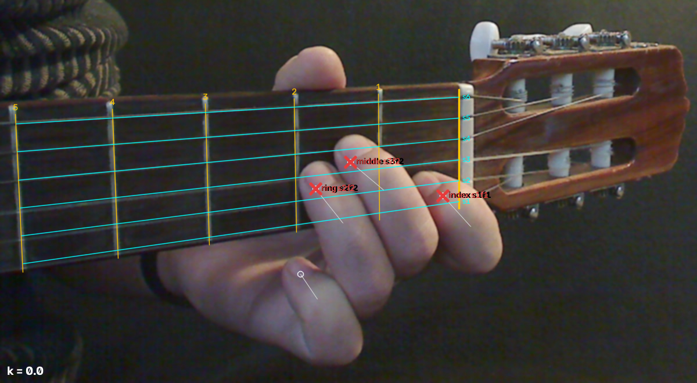

# FretCoach 技術可行性研究

給 proposal 第 3 節（方法）與第 4 節（API／函式庫）使用 · 2026-11-17

## 結論

**可以做到，但有三個前提**：

1. **指尖點要修正**：MediaPipe 的指尖點偏向手掌約 5 mm，比半個弦距還多。不修正的話，每根手指都判到隔壁弦。
2. **要多畫面平均**：單一畫面判斷三指全對只有 58%，平均 10 個畫面後提高到 94%。
3. **鏡頭要拍到手掌和手腕**：只拍到手指的特寫，MediaPipe 根本找不到手。

處理速度不是問題：MediaPipe 每格只要 3 ms，遠低於課堂講的 100 ms 回饋門檻。

---

## 1. 為什麼「判斷是哪一弦」最難

### 1.1 指板上的容許誤差

判斷正確的條件是：指尖離目標弦的距離小於半個弦距。

| 項目 | 民謠吉他 | 古典吉他 | 說明 |
| --- | --- | --- | --- |
| 琴枕處 6→1 弦的距離 | 約 36.5 mm | 約 43 mm | 弦距 × 5 |
| 相鄰弦距 | **約 7.3 mm** | **約 8.6 mm** | 民謠吉他弦距參考 [cmuse 計算表](https://www.cmuse.org/?p=71095)（7.29 mm） |
| **判斷弦的容許誤差** | **±3.6 mm** | **±4.3 mm** | 半個弦距 |
| 第 1 格長度 | 36.2 mm | 36.5 mm | 十二平均律，弦長 645／650 mm |
| 第 5 格長度 | 28.7 mm | 29.0 mm | 同上 |
| **判斷格的容許誤差** | 約 ±10 mm 以上 | 約 ±10 mm 以上 | 手指通常按在琴格後方，離兩側都有距離 |

第 n 格琴格到琴枕的距離是 d_n = L(1 − 2^(−n/12))，L 是弦長。

**結論：判斷「格」很容易，判斷「弦」的容許誤差只有 3–4 mm。**

### 1.2 換算成像素：「偏幾個像素就判錯」是幾個？

假設一般 webcam 水平視角約 70°，琴頸在畫面中央：

| 鏡頭距離 | 解析度 | 每像素約多少 mm | 民謠吉他容許誤差 | 古典吉他容許誤差 |
| --- | --- | --- | --- | --- |
| 30 cm | 1080p | 0.22 | 17 px | 20 px |
| 40 cm | 1080p | 0.29 | 12 px | 15 px |
| 40 cm | 720p | 0.44 | 8 px | 10 px |
| 60 cm | 1080p | 0.44 | 8 px | 10 px |
| 60 cm | 720p | 0.66 | **6 px** | 7 px |

實驗用的照片量到 0.22–0.26 mm/px，跟表中 30 cm、1080p 的情況相近。

### 1.3 MediaPipe 的精度上限不在鏡頭解析度

我們讀了模型檔：手掌偵測模型的輸入是 192×192，手指關節點模型是 **224×224**。MediaPipe 先找到手，再把手部那一塊縮放成 224×224 交給關節點模型。

所以，不論鏡頭多少畫素，**模型看到的整隻手永遠只有 224×224 像素**。若手部裁切範圍約 20 cm，每個模型像素約等於 1 mm（估計值）。提高鏡頭解析度對指尖精度幫助有限，但能讓指板校正更準。

### 1.4 文獻中的 MediaPipe 誤差

**目前沒有研究直接量過 MediaPipe 指尖位置的毫米級誤差**。最接近的數據有三項：

| 研究 | 量的是什麼 | 結果 |
| --- | --- | --- |
| Zhang et al. (2020)，MediaPipe Hands 原始論文 | 關節點誤差，以手掌大小正規化 | Full 模型 10.05（論文 Table 3）；實景與合成資料合併訓練後為 13.4%（Table 2） |
| Wolke et al. (2025), *Scientific Reports* | 手抖幅度估計誤差，以動作捕捉系統為標準 | 中位數 **5 mm**（2D 座標）；用 3D world 座標時為 11 mm |
| Sprague et al. (2025), *Sensors* | 手指關節角度誤差，以 Vicon 為標準 | MediaPipe 平均 RMSE 22.5°，Leap Motion 2 為 14.8° |

Wolke et al. 的模擬也發現：**鏡頭從上方、略偏側面拍攝時最準；越接近正對手的角度，誤差越大**。

文獻誤差約 5 mm，比我們的容許誤差（3.6–4.3 mm）還大，所以**一定要修正和平均**。這也是下面做實驗的原因。

---

## 2. 實驗

### 實驗設定

- **測試照片**：Wikimedia Commons 的古典吉他按 Am 和弦照片（[Chord_Am.jpg](https://commons.wikimedia.org/wiki/File:Chord_Am.jpg)，CC BY-SA 3.0，作者 Mjchael），1200×660，正面拍攝。
- **指板校正**：人工標出四個點（第 6、1 弦在琴枕處與第 5 格處），用 homography 把畫面座標轉成指板上的毫米座標。疊回照片的格線與實際琴格、琴弦吻合（見 2.1 節的圖）。
- **正確答案**：Am 和弦。食指按第 2 弦第 1 格，中指按第 4 弦第 2 格，無名指按第 3 弦第 2 格。

### 2.1 E1：指尖點有系統性偏差，需要修正

MediaPipe 的指尖點（TIP）落在手指末端的內側，實際按弦的位置在它更前面一點。我們把接觸點設成：

接觸點 = TIP + k × (TIP − DIP)

意思是沿著「遠端指節 → 指尖」的方向，再往外推 k 倍的距離。

| | 食指 | 中指 | 無名指 |
| --- | --- | --- | --- |
| k = 0（原始指尖）偏差 | 5.5 mm | 5.1 mm | 4.9 mm |
| k = 0 判斷結果 | ✗ 判成第 1 弦 | ✗ 判成第 3 弦 | ✗ 判成第 2 弦 |
| k = 0.4 判斷結果 | ✓ | ✓ | ✓ |

- 三根手指的偏差**方向相同、大小相近（約 5 mm）**，是系統性偏差，可以用固定公式修正。
- **k = 0.10–0.65 時三指全對**，容許範圍很寬，不需要精準調整。我們採用 k = 0.4。

修正前後對照（白色空心圈是原始指尖，實心點是修正後的接觸點）：

| k = 0（三指全錯） | k = 0.4（三指全對） |
| --- | --- |
|  |  |

### 2.2 E2：單一畫面不夠穩，要多畫面平均

把同一張照片做 60 種隨機變化：平移 ±15 px、縮放 ±8%、旋轉 ±3°、亮度 ±20%、加入雜訊、JPEG 壓縮品質 50–90。用來模擬鏡頭晃動、光線變化和畫質差異。

| 指標 | 結果 |
| --- | --- |
| 偵測到手 | 53 / 60（88%） |
| 接觸點的標準差（橫跨弦的方向） | 食指 3.3 mm、中指 2.4 mm、無名指 2.9 mm，平均 **2.9 mm** |
| 單一畫面三指全對 | 31 / 53（**58%**） |

再把多個畫面的接觸點平均後判斷（從 53 張中隨機抽組合，各抽 500 組）：

| 平均幾個畫面 | 1 | 3 | 5 | 10 |
| --- | --- | --- | --- | --- |
| 三指全對的比例 | 57%（抽樣誤差，實數為 58%） | 73% | 81% | **94%** |

以 30 fps 計，平均 10 個畫面約 0.33 秒，跟 dwell 機制的等待時間差不多，使用者不會覺得變慢。

**注意**：這 60 張變化照片的誤差彼此獨立；真實影片相鄰畫面的誤差有關聯，平均的效果會比 94% 差一些。實際數字要等錄影實測（第 5 節）。

### 2.3 E3：誤差要多小才分得出相鄰的弦

用模擬計算：在不同的隨機誤差 σ 和系統偏差下，判斷到正確弦的機率。

| 隨機誤差 σ | 1 mm | 2 mm | 3 mm | 4 mm |
| --- | --- | --- | --- | --- |
| 民謠吉他，單一畫面 | 100% | 93% | 78% | 64% |
| 民謠吉他，另有 3 mm 系統偏差 | 74% | 63% | 57% | — |

- 隨機誤差要壓到 **2 mm 以下**，單一畫面才有九成以上的準確率。實測的 2.9 mm 不夠，所以要多畫面平均。
- **系統偏差的傷害比隨機誤差大**。即使隨機誤差只有 1 mm，只要有 3 mm 偏差，準確率就掉到 74%。所以 E1 的修正是必要的。

### 2.4 E4：速度

把照片做成 3 秒、30 fps 的模擬 webcam 影片（加入雜訊、亮度閃爍和 ±1 px 晃動），用 `webcam_demo.py` 的完整流程跑：

| 指標 | 結果 |
| --- | --- |
| MediaPipe 每格處理時間 | 平均 **3.0 ms**，95 百分位 3.1 ms（Apple M5 筆電，VIDEO 追蹤模式） |
| 偵測到手 | 90 / 90 格 |
| 三指全對（k = 0，不修正） | 34 / 90 格 |
| 三指全對（k = 0.4，平均 10 格） | **90 / 90 格** |

課堂提到回饋要在 **100 ms 內**、畫面要 **> 10 fps**，這兩項都很寬裕。較舊的筆電會慢一些，但 MediaPipe 論文在 2018 年的 Pixel 3 手機上也只要 16 ms。

這段測試影片是同一張照片做出來的，手完全沒動，只能證明流程可以跑、速度夠快，不能代表真實演奏的準確率。

### 2.5 E5：什麼時候 MediaPipe 找不到手

另外拿 3 張近距離特寫照片測試（Wikimedia Commons）：

| 照片 | 拍攝方式 | 預設門檻（0.3） | 降低門檻（0.05）後 |
| --- | --- | --- | --- |
| Do7+.JPG（Cmaj7） | 正面特寫，只拍到手指 | 找不到 | 仍找不到 |
| C-major chord.jpg | 演奏者視角往下看 | 找不到 | 找得到，但手部骨架是錯的 |
| B add11.jpg | 斜角，手大多被琴頸遮住 | 找不到 | 加邊框後偶爾找到 |

- MediaPipe 要**先偵測到手掌**，才會去找手指。畫面裡只有手指時，第一步就失敗。
- 演奏者視角只看得到指甲，看不到按弦的位置。即使找到指尖，「DIP → TIP」的方向也不可靠，E1 的修正就無法套用。

**結論：鏡頭要放在演奏者前方、略高於琴頸，距離 40–60 cm，畫面要拍到手掌和手腕。** 這也符合 Wolke et al. 的發現（略高、略偏側面的角度最準）。

---

## 3. 實驗帶來的設計決策

| 問題 | 做法 | 參數 | 依據 |
| --- | --- | --- | --- |
| 指尖點偏向手掌約 5 mm | 沿 DIP→TIP 方向外推修正 | k = 0.4（0.10–0.65 都可） | E1 |
| 單一畫面判斷不穩 | 在指板座標（mm）上平均最近幾個畫面的接觸點 | 10 個畫面 | E2、E3 |
| 手指還在移動時就判錯，造成 Midas touch | **dwell**：手指停穩一段時間後才判斷，移動中顯示灰點 | 0.6 秒；移動超過 3 mm 就重新計時 | 課程 W7 |
| 拍不到手掌就找不到手 | 鏡頭放在前方略高處，畫面包含手掌和手腕 | 距離 40–60 cm | E5、Wolke et al. |
| 指板位置要先知道 | 開始時點四下校正，之後指板不能動；延伸版改貼 ArUco 標記自動追蹤 | 第 6、1 弦 × 琴枕、第 5 格 | — |
| 判斷弦的容許誤差小，判斷格的容許誤差大 | 回饋優先提示「格」的錯誤；弦只差一條且離界線很近時，標成「不確定」而不是判錯 | 離界線 < 1 mm 視為不確定（建議值，尚未實作） | E3 |
| 約 8% 男性有紅綠色弱 | 對錯同時用形狀區分：綠色圓點代表對，紅色叉代表錯 | — | 課程 W2 |
| 回饋要即時 | MediaPipe VIDEO 追蹤模式 | 每格 3 ms | E4、課程 W2 |

---

## 4. 建議的第 3 節內容（可以直接改寫進 proposal）

### 3.1 系統流程

每個畫面依序做以下步驟：

1. **指板校正**（只做一次）：使用者在畫面上點四下，標出第 6、1 弦在琴枕與第 5 格的位置。系統計算 homography，把畫面座標轉成指板座標（mm）。琴格位置用十二平均律算出：d_n = L(1 − 2^(−n/12))。
2. **手部追蹤**：用 MediaPipe Hand Landmarker（VIDEO 模式）取得 21 個關節點。
3. **接觸點修正**：MediaPipe 的指尖點偏向手掌約 5 mm（E1）。改用 TIP + 0.4 × (TIP − DIP) 作為按弦的位置。
4. **座標轉換**：把接觸點轉成指板座標，找出最近的弦，以及它落在哪兩條琴格之間。
5. **時間平滑**：平均最近 10 個畫面的位置（E2：單一畫面 58% → 10 個畫面 94%）。
6. **Dwell 判斷**：手指停穩 0.6 秒才判斷，避免手指還在移動時就提示錯誤（Midas touch）。
7. **和弦比對與回饋**：跟和弦資料庫比對。對的手指顯示綠色圓點，錯的顯示紅色叉並連到目標位置。一次只顯示一句最重要的提示。

### 3.2 技術風險與對策

| 風險 | 實驗證據 | 對策 |
| --- | --- | --- |
| 判斷弦的容許誤差只有 ±3.6 mm（民謠吉他） | 文獻誤差約 5 mm；實測單一畫面 2.9 mm | 接觸點修正 + 10 個畫面平均 |
| 手指互相遮擋、只拍到手指 | 4 張照片中 3 張偵測失敗 | 鏡頭拍到手掌和手腕；偵測不到時提示使用者調整鏡頭 |
| 吉他移動後校正失效 | — | 重新校正；延伸版用 ArUco 標記自動追蹤 |
| k 值因人而異 | 只用一張照片測過 | 錄影實測後，必要時加入「先按一個已知和弦」的個人校正步驟 |

### 3.3 技術評估（回答 RQ1）

錄製 4 位演奏者、8 個和弦的影片，人工標註每根手指的正確弦格，計算：

- 每根手指的弦、格判斷準確率（目標 ≥ 85%）
- 不同 k 值與平均畫面數的影響（重做 E1、E2，改用真實影片）
- 每格處理時間（目標 < 100 ms）

---

## 5. 建議的第 4 節內容

以下版本已在本機（Python 3.11、macOS、Apple M5）安裝並跑過。

| 函式庫 | 版本 | 用途 | 必要性 |
| --- | --- | --- | --- |
| Python | 3.11 | 開發語言（實驗都在 3.11 跑過；用 uv 建立獨立環境，不動到系統的 Python） | 必要 |
| [MediaPipe](https://ai.google.dev/edge/mediapipe/solutions/vision/hand_landmarker) Hand Landmarker | 1.2.3 | 21 個手部關節點，VIDEO 追蹤模式。模型檔 `hand_landmarker.task`（7.8 MB，內含 192×192 手掌偵測與 224×224 關節點兩個模型） | 必要 |
| [OpenCV](https://opencv.org/)（opencv-contrib-python） | 5.0.0 | 鏡頭擷取、homography（`getPerspectiveTransform`、`perspectiveTransform`）、畫面疊加；延伸版用 `cv2.aruco` 偵測標記、Canny + Hough 偵測琴格 | 必要 |
| NumPy | 2.4.6 | 座標運算、平滑 | 必要 |
| Matplotlib | — | 實驗結果作圖 | 分析用 |
| [Ultralytics YOLO](https://docs.ultralytics.com/) | — | 延伸版：偵測琴頸四角，取代人工校正。可用 jasraj-jsa 公開的 1,619 張指板標註照片 | 選配 |
| [librosa](https://librosa.org/) | — | 選配：以 chroma 特徵從聲音驗證和弦 | 選配 |
| pandas、SciPy | — | 使用者實驗的統計檢定 | 分析用 |

---

## 6. 限制

這份研究證明「做得到」，但還不能證明「準確率夠高」：

- **只用了一張照片**：一個人、一個和弦、一把古典吉他。k = 0.4 是用同一張照片找出來的，有過度擬合的風險。不過 0.10–0.65 都能全對，這個風險不大。
- **E2 的變化是人工模擬的**，真實影片相鄰畫面的誤差有關聯，平均效果會打折。
- **指板四角是人工標的**，沒有測試自動偵測。
- **`webcam_demo.py` 的視窗與滑鼠校正沒有實測**（這台電腦沒有接鏡頭和吉他），只用模擬影片測過運算流程。

下一步：拿自己的吉他跑 `webcam_demo.py`，錄幾段影片，重做 E1、E2。

---

## 7. 檔案位置

| 檔案 | 內容 |
| --- | --- |
| `demo/` | 程式碼，使用方式見 `demo/README.md` |
| `results/` | 實驗圖、疊圖、`summary.json`（所有數字）。測試影片沒有放進 repo，可用 `demo/make_test_video.py` 重新產生 |
| `test_images/` | 測試照片（Wikimedia Commons，授權見 `test_images/ATTRIBUTION.md`） |

## 參考資料

- Zhang, F., Bazarevsky, V., Vakunov, A., et al. (2020). [MediaPipe Hands: On-device real-time hand tracking](https://arxiv.org/abs/2006.10214). *CVPR Workshop on Computer Vision for AR/VR*.
- Wolke, R., Welzel, J., Maetzler, W., Deuschl, G., & Becktepe, J. (2025). [Validity of tremor analysis using smartphone compatible computer vision frameworks](https://pmc.ncbi.nlm.nih.gov/articles/PMC12008214). *Scientific Reports, 15*, 13391.
- Sprague, A. H., Vogel, C., Williams, M., Wolf, E., & Kamper, D. (2025). [Evaluation of commercial camera-based solutions for tracking hand kinematics](https://pmc.ncbi.nlm.nih.gov/articles/PMC12473350/). *Sensors, 25*(18), 5716.
- Burns, A.-M., & Wanderley, M. M. (2006). [Visual methods for the retrieval of guitarist fingering](https://nime.org/proc/nime2006_burns/). *NIME 2006*, 196–199.
- [CVMusic](https://github.com/KalnBrs/CVMusic)：同樣用 MediaPipe 偵測指板與手指位置的開源專案。
- [jasraj-jsa / Exploring Guitar Chord Recognition with Vision Models](https://github.com/jasraj-jsa/Exploring-Guitar-Chord-Recognition-with-Vision-Models)：1,619 張指板標註照片。
- 測試照片：[Chord_Am.jpg](https://commons.wikimedia.org/wiki/File:Chord_Am.jpg)（CC BY-SA 3.0, Mjchael）、[Frets, guitar neck, C-major chord.jpg](https://commons.wikimedia.org/wiki/File:Frets,_guitar_neck,_C-major_chord.jpg)（公眾領域）、[Do7+.JPG](https://commons.wikimedia.org/wiki/File:Do7%2B.JPG)（CC BY-SA 3.0, Elenaf）、[B add11 guitar chord.jpg](https://commons.wikimedia.org/wiki/File:B_add11_guitar_chord_Siadd11_accordo_chitarra-.jpg)（CC BY 2.0）。
